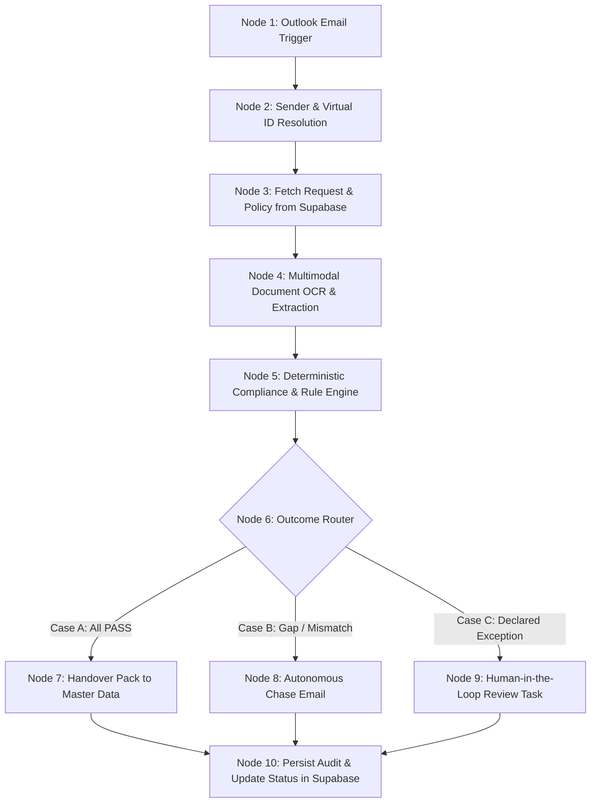

# Pravah AI — Supervity Auto Workflow Specification
### Complete Node-by-Node Build Guide for auto.supervity.ai

This document specifies the exact node-by-node configuration required to build **Pravah AI** on **Supervity Auto** ([https://auto.supervity.ai/](https://auto.supervity.ai/)).

---

## 1. Workflow Overview

- **Workflow Name:** `Pravah AI - Vendor Onboarding Employee`
- **Domain:** Domain B — Vendor & Procurement Lifecycle
- **Track:** Track B1 — Vendor Onboarding
- **Trigger:** Inbound email to connected Microsoft Outlook Mailbox 1 (The Desk)
- **Primary System of Record:** Supabase Cloud PostgreSQL (`pravah-vendorflow`)



---

## 2. Node-by-Node Specification

### Node 1: Trigger — Inbound Outlook Email
- **Connector:** Microsoft Outlook
- **Account:** Personal Outlook account (Mailbox 1: `vendor.onboarding@ashvakagroup.in` proxy)
- **Folder Watched:** `Inbox`
- **Filter Condition:** 
  ```text
  Subject CONTAINS "Vendor registration" OR Subject CONTAINS "VOR-"
  ```
- **Output Variables:**
  - `email_id`: Unique message ID
  - `subject`: Email subject
  - `from_address`: Sender email
  - `received_datetime`: Timestamp
  - `body_text`: Plain text email body
  - `attachments`: Array of attached files (PDFs)

---

### Node 2: Sender & Virtual ID Resolution (Operator / Code Block)
- **Purpose:** Handles the hackathon `On behalf of:` header convention and extracts the request ID.
- **Logic:**
  ```python
  import re

  body = context["body_text"]
  # 1. Resolve Virtual Sender if On behalf of header is present
  on_behalf_match = re.search(r"On behalf of:\s*(.+?)<(.+?)>", body, re.IGNORECASE)
  if on_behalf_match:
      sender_name = on_behalf_match.group(1).strip()
      sender_email = on_behalf_match.group(2).strip()
  else:
      sender_name = ""
      sender_email = context["from_address"]

  # 2. Extract Request ID from Subject or Body (e.g. VOR-26-0567)
  subj_match = re.search(r"(VOR-\d{2}-\d{4})", context["subject"])
  if subj_match:
      request_id = subj_match.group(1)
  else:
      body_match = re.search(r"(VOR-\d{2}-\d{4})", body)
      request_id = body_match.group(1) if body_match else None

  return {
      "request_id": request_id,
      "virtual_sender_name": sender_name,
      "virtual_sender_email": sender_email
  }
  ```

---

### Node 3: Fetch Request & Requirements (Supabase Integration)
- **Connector:** Supabase PostgreSQL / REST API
- **Action 1 (Query Request):**
  - Table: `onboarding_request`
  - Filter: `request_id = {{request_id}}`
  - Fields: `buyer_name`, `buyer_email`, `company_code`, `plant_code`, `purchase_category`, `vendor_name_as_typed`, `constitution_declared`, `state_declared`, `msme_declared`
- **Action 2 (Query Document Requirements):**
  - Table: `document_requirement`
  - Filter: `is_mandatory = 'Yes'`

---

### Node 4: Multimodal Document OCR & Extraction (AI Employee Node)
- **Input:** `attachments` array from Node 1
- **Prompt:**
  ```text
  You are an enterprise document extractor for Ashvaka Industries Group.
  Inspect each attached document and extract the structured key-value pairs.
  Do NOT guess, extrapolate, or fabricate values. If a field is illegible or missing, return null.

  Required fields:
  - Form GST REG-06: legal_name, trade_name, gstin, state_code, constitution
  - PAN Card: pan_number, name_on_pan, entity_status_char
  - Bank Proof (Bank Letter or Cancelled Cheque): bank_name, account_number, ifsc_code, account_holder_name
  - ISO / Insurance / Compliance: certificate_name, expiry_date, standard
  ```
- **Output Schema:** JSON formatted key-values.

---

### Node 5: Deterministic Compliance & Rule Engine (Python / Operator)
- **Input:** Extracted JSON + Request Metadata from Supabase
- **Execution:** Calls [`tools/pravah_engine.py`](file:///c:/Users/Harshit/Desktop/vendor_%20procurement_lifecycle/tools/pravah_engine.py)
- **Rule Matrix Evaluated:**
  - `PRS-01`: All mandatory documents present for category (`EQUIP_RENTAL`).
  - `VAL-01`: GSTIN 15-character structure & check character.
  - `VAL-02`: PAN 10-character structure & 4th character ('C' for company, 'F' for LLP, 'P' for proprietor).
  - `VAL-03`: IFSC 11-character structure (`^[A-Z]{4}0[A-Z0-9]{6}$`).
  - `VAL-04`: GSTIN state code matches declared state.
  - `EXP-01`: Expiry date >= `2026-10-09 18:00 IST`.
  - `XDC-01`: Legal name identity across GST, PAN, COI.
  - `XDC-02`: Embedded PAN in GSTIN == PAN on card.
  - `XDC-03`: Account holder on bank proof matches legal name (applying Ashvaka Name Matching Rules: `Pvt Ltd` == `Private Limited`, dropping `M/s`, but failing if extra words like `Industries` exist).
  - `DUP-01`: Check `vendor_master` for matching PAN, GSTIN, or Bank Account.
- **Output:**
  - `overall_status`: `PASS` | `GAP_DETECTED` | `EXCEPTION_HALT`
  - `rule_results`: Dictionary of individual rule statuses
  - `discrepancy_details`: Text explanation of failures

---

### Node 6: Outcome Router (Conditional Gateway)
- **Condition 1 (EXCEPTION_HALT):**
  - If `DUP-01` == `FAIL` (Duplicate PAN/GSTIN/Bank in Master) OR `EXP-03` triggered (Expired doc with receipt)
  - Route to **Node 9 (Human Review Task)**
- **Condition 2 (GAP_DETECTED):**
  - If any document is missing or name mismatch detected (e.g. `XDC-03` failed)
  - Route to **Node 8 (Autonomous Chase Email)**
- **Condition 3 (All PASS):**
  - All mandatory rules PASS
  - Route to **Node 7 (Handover Pack to Master Data)**

---

### Node 7: Verified Handover Pack (Outlook + Supabase)
- **Action 1 (Email Handover):**
  - Send email to `vendor.master@ashvakagroup.in` (redirected to Mailbox 2 via `contact_map`).
  - Subject: `VERIFIED PACK: Onboarding Request {{request_id}} - {{legal_name}}`
  - Body: Structured JSON payload with all verified master data fields.
- **Action 2 (Update Supabase):**
  - Table: `onboarding_request`
  - Update: `request_status = 'VERIFIED_PACK_HANDED_OVER'`

---

### Node 8: Autonomous Chase Email (Outlook)
- **Recipient:** Vendor contact email (redirected to Mailbox 2 via `contact_map`).
- **CC:** Buyer email (`farhan.shah@ashvakagroup.in` via Mailbox 2).
- **Subject:** `RE: Vendor registration | {{request_id}} | {{legal_name}}`
- **Body Template:**
  ```text
  Dear {{vendor_contact_name}},

  Thank you for submitting your onboarding documents for Ashvaka Industries Group.

  During automated compliance verification for request {{request_id}}, the following discrepancy was identified:
  {{discrepancy_details}}

  Please reply to this email with the rectified document at your earliest convenience.

  Regards,
  Vendor Onboarding Desk
  Ashvaka Industries Group
  vendor.onboarding@ashvakagroup.in
  ```
- **Log Outbound Chase:** Insert record into `chase_log`.

---

### Node 9: Human-in-the-Loop Review Task (Supervity HITL Node)
- **Assignee:** Procurement Lead (`Foram Shukla` / Team Evaluator)
- **Modal Title:** `Compliance Exception: Request {{request_id}}`
- **Context Package Displayed:**
  - Vendor Name As Typed vs Matched Existing SAP Vendor
  - Matching Identifier (PAN / GSTIN / Bank Account Number)
  - Existing SAP Vendor LIFNR
- **Actions Available to Human Approver:**
  1. `APPROVE_MERGE` (Merge into existing SAP record)
  2. `APPROVE_STATE_EXTENSION` (Add state GSTIN)
  3. `REJECT_DUPLICATE` (Mark request as duplicate)
- **Outcome:** Records human decision into Supabase `review_tasks` table.

---

### Node 10: Immutable Audit Logging (Supabase)
- **Table:** `verification_audit`
- **Fields:** `request_id`, `rule_id`, `status`, `evidence_summary`, `detected_value`, `expected_value`, `human_review_required`, `evaluated_at`
